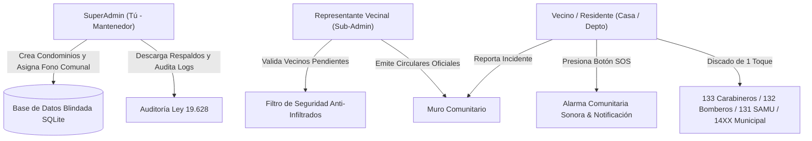

# Manual de Operación, Seguridad y Modelo de Negocio: CondoSeguro Chile

---

## 1. Modelo de Negocio y Cómo Ofrecerlo a Condominios Pequeños

### El Problema en Chile
En Chile existen miles de condominios pequeños (10 a 60 casas o departamentos) que **no tienen presupuesto para contratar conserjes ni guardias 24/7** (cuyo costo supera los $2.000.000 a $3.000.000 CLP mensuales en gastos comunes).
* Tienen una única **representante o presidente/a de junta de vecinos** elegida entre ellos mismos.
* El grupo de WhatsApp comunitario suele desordenarse con mensajes irrelevantes, perdiéndose las alertas críticas.
* Ante un portonazo, robo o emergencia médica, los vecinos no tienen forma rápida de pedir auxilio ni de saber qué casa está en peligro.

### La Propuesta de Valor (Pitch de Venta)
> *"Por solo $25.000 a $40.000 CLP mensuales por todo el condominio (menos de $1.000 a $1.500 CLP por casa), entregamos una red privada y blindada de seguridad vecinal con botón de pánico SOS instantáneo, discado directo a Carabineros y Seguridad Municipal de su comuna, y un panel exclusivo para que la representante controle quién ingresa y difunda circulares oficiales sin spam."*

---

## 2. Roles del Sistema y Flujo Operativo

### Roles y Permisos:
1. **SuperAdmin (Tú / Mantenedor del Servicio):**
   * Control maestro de todos los condominios afiliados.
   * Da de alta nuevos condominios indicando Comuna y Teléfono de Seguridad Ciudadana (ej: Macul 1444, Providencia 1405, Las Condes 1402).
   * Monitorea la salud del sistema y descarga copias de respaldo de la base de datos en 1 clic.
   * Visualiza los logs inmutables de auditoría de la Ley 19.628.
2. **Sub-Admin (Representante Vecinal del Condominio):**
   * **Filtro Anti-Infiltrados:** Revisa las solicitudes de los nuevos vecinos que se registran y los **Aprueba** o **Suspende**, garantizando que ninguna persona ajena entre a la red.
   * Publica Comunicados Oficiales que se fijan en el muro de todos los residentes.
   * Atiende y marca como resueltas las alertas de emergencia.
3. **Residente / Vecino:**
   * Registro rápido: Nombre, Casa/Depto, Teléfono, Correo, Contraseña y Consentimiento Legal.
   * **Botón SOS de Pánico:** Notifica a toda la comunidad con alarma sonora indicando su nombre y casa/depto.
   * **Discado Directo de 1 Toque:** Enlaces nativos `tel:` para llamar al instante a Carabineros (133), Bomberos (132), SAMU (131), PDI (134) o Seguridad Municipal.
   * **Reporte de Incidentes:** Informa sobre autos extraños, portones abiertos o ruidos molestos.

---

## 3. Seguridad Técnica y Cumplimiento de la Ley N° 19.628 de Chile

La plataforma fue diseñada bajo estándares formales de ciberseguridad (OWASP Top 10 y Ley N° 19.628 de Protección de la Vida Privada de Chile):

### A. Prevención de Desbordamiento de Memoria y Ataques DoS (Memory Exhaustion / JSON Bombs)
* **Middleware `PayloadSizeLimitMiddleware`:** Bloquea en el punto de entrada cualquier petición HTTP que supere **64 KB** (`HTTP 413 Payload Too Large`). Impide que usuarios maliciosos saturen la memoria RAM del servidor enviando textos o JSON gigantescos.
* **Esquemas Pydantic Estrictos:** Todos los campos de entrada tienen límites máximos estrictos (`max_length=70`, `max_length=600`, etc.) y prohibición de atributos no declarados (`extra = 'forbid'`).
* **Rate Limiting en Memoria:** 
  * Inicio de sesión limitado a 8 intentos por minuto para impedir ataques de fuerza bruta.
  * Botón SOS con debounce de 20 segundos por usuario para evitar spam o flooding accidental.

### B. Prevención de Inyecciones de Scripts (XSS) y SQL Injection
* **Sanitización Obligatoria en Backend:** Todo texto ingresado por los usuarios pasa por `html.escape()`, convirtiendo etiquetas peligrosas como `<script>` en entidades seguras (`&lt;script&gt;`).
* **Encabezados HTTP de Hardening:**
  * `Content-Security-Policy`: Restringe la ejecución de scripts a fuentes autorizadas.
  * `X-Content-Type-Options: nosniff`: Evita MIME-sniffing.
  * `X-Frame-Options: SAMEORIGIN`: Evita ataques de Clickjacking.
* **SQL Injection:** Todas las consultas a SQLite están parametrizadas con variables `?` (cero concatenación de cadenas).

### C. Cumplimiento de la Ley 19.628 (Protección de Datos Personales)
* **Minimización de Datos:** Solo se capturan los datos indispensables para la seguridad vecinal (Nombre, Unidad y Teléfono). No se almacenan datos financieros, RUT ni datos sensibles.
* **Consentimiento Expreso:** Checkbox obligatorio en el registro con registro inmutable en base de datos (`consent_law_19628 = 1` y `consent_timestamp`).
* **Aislamiento Multi-Condominio (Tenant Isolation):** Cada consulta está aislada por `condo_id`. Un vecino jamás puede ver usuarios, alertas ni datos de otro condominio.
* **Criptografía de Contraseñas:** Hash con `bcrypt` (factor de costo 12 y salteo individual por usuario).
* **Trazabilidad y Auditoría:** Tabla `audit_logs` que registra fecha, IP y acción de cada evento crítico.

---

## 4. Guía de Puesta en Marcha y Demostración

### Modo 1: Prototipo Autónomo Móvil (Para Enviar por Correo a Clientes)
* Archivo en tu Escritorio: **`condo_seguro_movil_demo.html`**
* **Cómo usarlo:** Puedes adjuntarlo por correo y abrirlo directamente en cualquier celular (Galaxy S25, iPhone) o PC sin instalar nada. Incluye un conmutador de roles en la parte superior para que la representante vecinal pruebe la experiencia de Vecino, Sub-Admin y Admin.

### Modo 2: Servidor Real en Producción / Red Local
* Acceso directo en tu Escritorio: **`CondoSeguro_Chile.bat`**
* **Cómo usarlo:** Haz doble clic para encender el servidor FastAPI. Se abrirá automáticamente en `http://localhost:8000`.
* **Credenciales de Demostración:**
  * **SuperAdmin (Tú):** `admin@condoseguro.cl` / `admin123456`
  * **Representante (Sub-Admin):** `representante@aromos.cl` / `representante123`
  * **Vecino (Casa 1):** `vecino1@aromos.cl` / `vecino123`
* **Respaldos:** En el panel de SuperAdmin, haz clic en *"Descargar Respaldo SQLite"* para respaldar toda la información de todos los condominios en 1 segundo.
